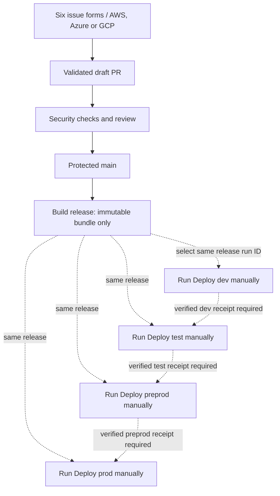

# Secure AI onboarding: AWS, Azure and GCP

Six GitHub issue forms onboard **LLM, MCP and A2A**, with separate **internal and external** forms for each. Every form selects **AWS, Azure or GCP**. Requests become validated **draft pull requests**; reviewed changes promote through isolated **dev, test, preprod and prod**, each with an independent trigger. **Konnect region is fixed to `us`.**

This implementation targets **Konnect AI Gateway 2.3.x**, with runtime **2.3.1** and **kongctl 1.28.4**. **Legacy Kong Gateway 2.3 is a different product and cannot use these native AI entities.** Upgrade/migrate and provision compatible AI Gateways before live deployment. This repository configures existing gateways; it does not provision cloud networks, data planes, WAFs, identities or upstream applications.

## What is included

- Six forms in `.github/ISSUE_TEMPLATE/`: `llm-internal`, `llm-external`, `mcp-internal`, `mcp-external`, `a2a-internal`, `a2a-external`.
- Twenty-four target files: `{aws|azure|gcp}-{internal|external}-{dev|test|preprod|prod}.yaml`.
- Strict issue parsing, schema and policy validation, secret scanning, and draft-PR creation.
- Hash-locked Python dependencies, SHA-pinned Actions, checksum-verified tools, secret scanning, dependency auditing, static analysis and workflow linting.
- Target-specific plan/read credentials, protected apply environments, isolated deployment runner groups, immutable bundles, stale-plan rejection, runtime readiness and protocol smoke checks.
- Read-only drift detection, reviewed recovery, tests, and editable diagrams in `docs/`.

## Placement and segregation

A **lane** is one cloud plus one exposure type. It contains four separate deployment targets. Each stage is triggered separately for one lane.

| Lane | Dev | Test | Preprod | Prod |
|---|---|---|---|---|
| AWS internal | `aws-internal-dev` | `aws-internal-test` | `aws-internal-preprod` | `aws-internal-prod` |
| AWS external | `aws-external-dev` | `aws-external-test` | `aws-external-preprod` | `aws-external-prod` |
| AZURE internal | `azure-internal-dev` | `azure-internal-test` | `azure-internal-preprod` | `azure-internal-prod` |
| AZURE external | `azure-external-dev` | `azure-external-test` | `azure-external-preprod` | `azure-external-prod` |
| GCP internal | `gcp-internal-dev` | `gcp-internal-test` | `gcp-internal-preprod` | `gcp-internal-prod` |
| GCP external | `gcp-external-dev` | `gcp-external-test` | `gcp-external-preprod` | `gcp-external-prod` |

**Internal/external describes client access to the gateway.** Internal ingress must be private. External ingress remains authenticated and must sit behind approved public-edge protections. It does not describe the location of the LLM provider: an internal AWS gateway can call an approved external provider. Model-provider choice and data-processing approval are separate decisions. US Konnect region does not establish US data-plane/provider residency.

Each enabled target needs a distinct AI Gateway UUID, namespace, cloud account/subscription/project context, target-scoped tokens, environment secrets and runner group. The compiler rejects reused non-placeholder gateway IDs and namespaces, placement mismatches and cross-target configuration leakage. A resource is rendered and smoke-tested only in the four stages of its chosen lane. Names are globally unique in the catalog; route overlap is checked within each lane.

```yaml
placement:
  cloud: aws
  exposure: internal
  data_classification: internal
```

All targets ship **disabled**. Configure and enable each target independently. Disabled targets are still schema-checked but cannot deploy. The bundle freezes the configuration for all four stages: configure and enable every stage you intend to promote into before building that release. Enabling or changing a target afterward requires a new release and a new dev verification. Enabled targets with no resources are not scheduled for drift checks. The three sample resources belong to `aws-internal`; replace or remove these examples before enabling that lane.

## Pipeline schematic




Dotted arrows represent required evidence, **not automatic triggers**. Each dispatch deploys exactly one cloud/exposure/stage target. Different lanes can run independently; promotion/recovery writes in the same lane share a concurrency group. GitHub concurrency is not a durable FIFO queue and may replace a pending run; inspect run status and dispatch again if needed. Other repositories and manual administrators are outside this lock.

## 1. Install and validate locally

Copy the contents of this directory, **including `.github`**, to the root of a private organization repository whose protected/default branch is `main`. A private organization repository is recommended because the workflow uses organization runner groups and internal endpoint metadata.

Use Python 3.12 as in CI. Core validation also works with Python 3.9+, but the complete scanner dependency lock requires Python 3.11+.

```bash
python3 -m venv .venv
source .venv/bin/activate
python -m pip install --require-hashes --only-binary=:all: -r requirements.lock
python -m unittest discover -s tests -v
python -m aiops validate
python -m aiops build --revision local
python -m aiops verify
python -m aiops targets
```

No deployment credentials are needed. `targets` initially returns `[]`. The build destination must be empty; use a new `--output` when rebuilding. Inspect `build/release/aws-internal-dev/kong.yaml`; provider secret references remain unresolved.

To run security checks locally:

```bash
python -m pip install --require-hashes --only-binary=:all: -r requirements-security.lock
python scripts/install_security_tools.py
.tools/gitleaks dir . --redact --no-banner --max-target-megabytes 2
# Run this next command inside your initialized Git repository:
.tools/gitleaks git . --redact --no-banner --log-opts="--all"
python -m bandit -r aiops scripts -ll -ii
python -m pip_audit -r requirements.lock --disable-pip --require-hashes
python -m pip_audit -r requirements-security.lock --disable-pip --require-hashes
.tools/actionlint -shellcheck= -pyflakes=
python scripts/check_workflow_security.py
```

## 2. Provision platform controls and configure targets

For each of the four stages of the selected lane, provision an existing Konnect AI Gateway in region `us`, data planes running the pinned 2.3.1 runtime and a minimum runtime version of 2.3. Use separate gateways between internal and external exposure and between stages. Configure the appropriate cloud scope and network boundary. See [the security design](SECURITY.md) for cloud patterns and limits.

Create an inbound AI Auth Strategy, authorized consumer groups and shared protocol-specific AI policies. Policies should cover quotas/request limits, logging/redaction and the controls appropriate to that protocol. A prompt policy is not a substitute for MCP tool authorization. Upstream authentication and private connectivity are platform prerequisites; arbitrary MCP/A2A bearer injection is not implemented here.

Edit `environments/<cloud>-<exposure>-<stage>.yaml`:

| Field | Configuration |
|---|---|
| `region` | Always `us`; other values fail validation |
| `cloud`, `exposure`, `stage` | Must match the filename |
| `cloud_scope` | Actual AWS account, Azure subscription or GCP project identifier |
| `gateway_id`, `namespace` | Exclusive to this target; no gateway reuse |
| `auth_strategy_id`, `consumer_groups` | Existing inbound auth strategy and allowed groups |
| `proxy_url` | Real HTTPS client gateway endpoint reachable from this target's deployment runner |
| `policy_profiles` | Existing policy names/IDs; every profile must be nonempty before enabling |
| `allowed_upstream_hosts` | Exact approved DNS hostnames; no wildcards or IP literals |
| `approved_providers` | Reviewed native provider types; defaults to `openai` |
| `allowed_data_classes` | Internal defaults: public/internal/confidential; external defaults: public only |
| `upstreams` | Stage-specific MCP/A2A URLs; intake can add mappings only to approved hosts |
| `controls` | Set the relevant ingress flag and common controls only after platform verification |
| `security_review_url` | HTTPS link to the infrastructure/security review evidence |
| `enabled` | Set `true` for this configured target; each stage is enabled independently |

The common control attestations are `egress_restricted`, `request_limits`, `audit_redaction` and `upstream_tls_verified`. Internal targets also require `private_ingress_verified`; external targets require `public_edge_verified`. These are **reviewed attestations**, not cloud API inspections. The workflow checks their presence/values and the evidence URL; it cannot prove the deployed WAF or firewall configuration. Keep the review current and enforce the cloud controls independently.

An enabled target cannot retain zero UUIDs, example endpoints, empty policies, missing groups, placeholder cloud scope or unverified controls. Restricted data is denied by default in both exposure groups. Changing allowlists, classifications, provider approvals or controls is a platform/security-owned configuration change, not something the form can authorize.

Approve new upstream hosts in a platform PR before submitting the service onboarding form. Use explicit DNS names for each stage. Both provider URL overrides and MCP/A2A upstreams are checked against target allowlists; private DNS and egress filtering must prevent DNS rebinding, metadata access and redirect-based bypasses at runtime.

## 3. Configure GitHub protections, secrets and runners

Repository settings are external to YAML; configure them before enabling deployment:

1. Enable Issues and Actions, set `main` as the default branch, and enable **Allow GitHub Actions to create and approve pull requests**. The intake uses this capability only to create draft PRs; it never approves or merges them. Leave default workflow token permissions read-only; the intake job requests only contents/write, pull-requests/write and issues/read.
2. Adapt `.github/CODEOWNERS.example` to real teams and rename it to `.github/CODEOWNERS`. Protect `main` with code-owner review, stale-review dismissal, resolved conversations and required status checks for the validation and security jobs. Select the actual check names after the first run. Disable bypasses and direct pushes for normal users/bots.
3. Create two GitHub Environments for each enabled target: `<target>-plan` and `<target>`. Restrict both to `main`. A full rollout uses 24 apply environments and 24 read-only plan environments; you may configure only the lanes you enable.
4. Put only `KONNECT_READ_TOKEN` in `<target>-plan`. Scope it to read/list this target's gateway and dependencies.
5. Put the individual secrets below in `<target>`. Do not place deployment credentials in repository secrets. Configure required reviewers on **all apply environments**, especially every external target and production target. Prevent self-review and administrator bypass where supported. Environment protections depend on your GitHub plan and must be configured in GitHub.
6. Create an organization runner group named `aiops-<target>` for each enabled target, containing ephemeral Linux x64 self-hosted runners. Restrict repository/workflow access to the protected deployment workflow where your GitHub plan supports it. Keep these groups unavailable to PR/issue jobs and fork code. Configure the runner service to destroy each runner after one job; a label alone does not make it ephemeral.

| Apply environment secret | Purpose |
|---|---|
| `KONNECT_TOKEN` | Target-scoped system-account token for required read/create/update AI operations |
| `AIOPS_LLM_AUTH_HEADER` | Complete provider header value, e.g. `Bearer <key>` or a raw provider key; needed only if this lane contains an LLM |
| `SMOKE_AUTH_VALUE` | Complete inbound header value for a least-privilege test consumer |

Secrets are individual values; the previous `AIOPS_SECRET_VALUES` JSON bundle is no longer used. The form uses the fixed credential reference `AIOPS_LLM_AUTH_HEADER`. Values are different per target. To support multiple independent provider credentials within one target, add explicit secret-to-environment bindings to the apply workflow and use matching `credential_env` references in reviewed manifests. Do not expose the whole `secrets` context or enable secret inheritance.

Plan jobs use GitHub-hosted runners and call Konnect only. Apply jobs use the target's runner group and need connectivity to the gateway client endpoint, Konnect, GitHub releases and the package index. Data planes separately need approved upstream connectivity. Pre-bake verified tools/dependencies into ephemeral images if your network forbids public package downloads.

GitHub environment reviewers form an **OR** approval gate; listing security and platform reviewers does not require both teams. If one approval from each team is mandatory, add an organization ruleset/custom protection check enforcing that requirement. CODEOWNERS alone likewise does not implement two-team approval. Runner groups require an organization setup; do not silently replace them with a shared unrestricted private runner.

## 4. Submit an issue form

In **Issues → New issue**, choose one of the six forms and select its gateway cloud. Supply a unique resource name, owner team, route and data classification. LLM forms collect provider/model/header plus optional native provider options. MCP/A2A forms collect four approved upstream URLs (dev, test, preprod and prod) and expected discovery names. Conversion MCP additionally needs native tool definitions.

The intake runs trusted `main` code on a GitHub-hosted runner. It reads the issue through the API as data, validates the full candidate, scans generated files for secrets, then creates `onboarding/issue-<number>` and a draft PR. It may create only one catalog manifest and, for MCP/A2A, four upstream mappings. It cannot change workflows, allowlists, credentials, cloud placement controls or enabled flags. It verifies that the checkout still matches `main` before generating a commit. No live endpoint is contacted during intake validation.

On validation failure, inspect the intake job's value-free error, correct the issue and retry. Issue edits trigger another run. Once a PR exists, edits do **not** overwrite reviewer changes or create a second PR; continue edits in that PR. If interrupted after branch creation but before PR creation, a maintainer must inspect/remove the orphan branch before rerunning. A closed PR remains associated with its issue; use a new issue for a replacement request.

PRs created with `GITHUB_TOKEN` may show **Approve workflows to run**. A maintainer must start those checks before merging. This is documented GitHub behavior; do not bypass required checks. A separately scoped GitHub App can replace this token if automatic PR-check execution is required. See [GitHub's workflow-trigger behavior](https://docs.github.com/en/actions/how-tos/write-workflows/choose-when-workflows-run/trigger-a-workflow).

Never put credentials or confidential payloads in an issue. The scanner prevents detected secrets from entering the generated branch, but it cannot remove secrets already submitted to GitHub; rotate exposed values and follow your incident process.

## 5. Build once and trigger each stage independently

Review the draft PR, policy fit, upstream ownership, data handling and rendered preview. Mark it ready after platform/security review and merge after required checks pass. **Build release** runs security checks/tests and uploads `ai-release`. It performs **no deployment**. Record its successful workflow run ID as `R`.

In GitHub **Actions**, select the relevant workflow, choose **Run workflow**, select branch **main**, and provide the inputs below. The `lane` is one of `aws-internal`, `aws-external`, `azure-internal`, `azure-external`, `gcp-internal`, or `gcp-external`.

| Independent workflow | Inputs | Required evidence |
|---|---|---|
| **Deploy dev** / `deploy-dev.yml` | `release_run_id=R`, `lane` | Successful Build release and its original artifact |
| **Deploy test** / `deploy-test.yml` | Same `R` and `lane`, `previous_run_id=D` | Successful Deploy dev run `D` for the exact release/lane |
| **Deploy preprod** / `deploy-preprod.yml` | Same `R` and `lane`, `previous_run_id=T` | Successful Deploy test run `T` for the exact release/lane |
| **Deploy prod** / `deploy-prod.yml` | Same `R` and `lane`, `previous_run_id=P` | Successful Deploy preprod run `P` for the exact release/lane |

**A successful stage does not trigger the next stage.** Start it when ready, even hours or days later, within artifact retention. Each stage repeats the security gate, verifies source/evidence artifacts, creates a read-only plan, waits for its own GitHub Environment approval, rechecks the plan, applies, checks runtime readiness, runs protocol tests and publishes `promotion-<lane>-<stage>/promotion.json`.

A later stage downloads the **original** `ai-release` artifact by its verified artifact ID. It never rebuilds the release. The gate verifies repository, main branch, expected workflow, event, successful completion, run attempt, source commit, original artifact identity, bundle digest, exact lane and preceding stage. Missing, expired, failed, mismatched or stage-skipping evidence blocks deployment. Target configuration must still match the trusted configuration at the current dispatch commit, so an old bundle cannot re-enable a currently disabled target or silently restore an older allowlist. If a target file changes, build a new release and restart its lane at dev.

The predecessor must have passed this release at least once; the gate is not a live check that the predecessor still runs that release today. There is no maximum evidence-age policy beyond artifact retention. Add an explicit freshness/active-version requirement if your release policy needs one. Deploying another lane has no prerequisite relationship to this lane.

Before approval, inspect `review-<target>` and the native configuration in `ai-release`. Plan summaries contain resource/field names rather than raw API values. Apply rejects a changed plan digest. An external change after the final comparison remains a race; coordinate operational writers.

For UI steps, CLI commands and troubleshooting, see **[Independent promotion runbook](docs/PROMOTIONS.md)**. A failed stage can be started again as a new dispatch with the same release ID after investigating partial state; it does not rebuild or automatically rerun earlier stages. Prefer a new dispatch to GitHub's “Re-run all jobs”, which can collide with immutable artifact names in the original run. If changing release content, use a new Build release ID and repeat all preceding stages.

The pipeline uses create/update only. Failed readiness or smoke verification stops that dispatch and cannot produce successful promotion evidence. No prune, automatic rollback, percentage canary or traffic switch is implemented. Start with a test cohort and expand access in a reviewed release.

LLM smoke tests generate small requests and can incur cost. MCP tests verify session setup and the exact authorized tool list. A2A tests verify the 0.3.0 agent card and skills. Forms do not enable tool calls or agent messages; optional read-only execution requires a reviewed manifest change. Expected tool names are assertions, not runtime tool ACLs.

## Local live execution, drift and recovery

For controlled local debugging only, securely supply the target environment variables and run the commands below. Local CLI execution does not enforce GitHub promotion provenance or approval gates; production operators should use the independent workflows and restrict direct write-token access.

```bash
python scripts/install_kongctl.py
export AIOPS_KONGCTL="$PWD/.tools/kongctl"
# Supply KONNECT_TOKEN, AIOPS_LLM_AUTH_HEADER (if needed), and SMOKE_AUTH_VALUE securely.
python -m aiops build --output build/live --revision local
python -m aiops plan --bundle build/live --environment aws-internal-dev --output build/review.json
# Review the plan and generated native configuration before apply.
PLAN_DIGEST="$(python -c "import json; print(json.load(open('build/review.json'))['plan_digest'])")"
python -m aiops apply --bundle build/live --environment aws-internal-dev \
  --expected-plan-digest "$PLAN_DIGEST" --output build/deployment.json
```

**Detect drift** runs daily at 04:17 UTC against enabled targets with each target's read-only plan environment. Exit code 2 means declared resources differ. It does not inventory undeclared/removed resources because this pipeline does not prune.

**Recover verified release** is independently dispatched with `release_run_id`, `lane`, `stage` and `previous_run_id` for a successful original Deploy run at that **same** target stage. This deliberately requires evidence that the chosen release previously passed that target; it is not a skip-stage shortcut. Recovery uses the normal plan/approval/verification gates and current target-configuration comparison. If restoring an older target configuration is required, align it through a reviewed main-branch change first. Artifacts must use this four-stage layout. Recovery cannot remove new resources, undo agent/tool actions, restore secrets or repair cloud infrastructure. Reconcile Git afterward. Original release artifacts and all promotion evidence must remain available (90-day retention); drift receipts use 14 days.

## Extend without coupling the pipeline

- Add protocols through `aiops/adapters.py`, the input schema and protocol tests; keep plan/apply/readiness interfaces stable.
- Add target configurations through the central placement inventory/schema if more clouds or exposure classes are needed; drift discovers enabled targets from configuration and each promotion selects one exact target.
- Add provider-specific authentication adapters for AWS Bedrock SigV4, Vertex IAM or other non-header flows. Selecting AWS/GCP hosting does not implement those provider authentication methods.
- For future cloud API steps or secret-manager access, use cloud workload federation/OIDC scoped to the repository, protected ref and exact environment, with short-lived least-privilege roles. This Konnect-only baseline requests no cloud token and stores no AWS/Azure/GCP access key.
- Keep shared auth strategies, policy definitions, cloud infrastructure and approved-host lists under separate platform ownership. Intake can reference them, but cannot grant itself approval.
- Update dependency/tool locks and native schema snapshots in reviewed PRs, rerunning security and protocol checks. Dependabot is configured for weekly Python/Action review; SHA/checksum/lock changes still need human review. After reviewing version changes in `requirements.txt` or `requirements-security.txt`, run `python scripts/update_dependency_locks.py --refresh`, verify a clean hash-enforced install, and rerun both audits. CI rejects version inventories that disagree with their locks.

## Evidence and source references

See `VALIDATION.txt` for checks actually run. Local/mocked validation does not establish connectivity, entitlement, private ingress, WAF policy or live cloud/Konnect deployment success.

- [GitHub issue form syntax](https://docs.github.com/en/communities/using-templates-to-encourage-useful-issues-and-pull-requests/syntax-for-issue-forms)
- [GitHub workflow security guidance](https://docs.github.com/en/actions/reference/security/secure-use)
- [GitHub environment protections](https://docs.github.com/en/actions/reference/workflows-and-actions/deployments-and-environments)
- [GitHub runner group isolation](https://docs.github.com/en/actions/how-tos/manage-runners/self-hosted-runners/manage-access)
- [GitHub OIDC](https://docs.github.com/en/actions/concepts/security/openid-connect)
- [Kong AI Gateway management](https://developer.konghq.com/ai-gateway/kongctl/)
- [Kong planning and recovery](https://developer.konghq.com/kongctl/declarative/planning/)
- [Kong runtime requirements](https://developer.konghq.com/kongctl/declarative/resource-behavior/)
- [MCP entities and ACLs](https://developer.konghq.com/ai-gateway/entities/ai-mcp-server/)
- [Agent entities](https://developer.konghq.com/ai-gateway/entities/ai-agent/)

Native schema snapshots retain Kong's license in `schemas/kongctl-1.28.4/LICENSE`.
